# Full transfer -- end-to-end flow, traced from the code

Every diagram below is a direct translation of one method's actual control flow (loops,
branches, retries, exact function names) -- not a paraphrase. Each diagram is labeled
with the exact file and method it maps to, so you can open that file side by side and
check it line for line. This is deliberately split into one diagram per method/stage
rather than one giant diagram -- a single graph with every branch in this scenario
would be unreadable.

For a higher-level, less granular view (what's confirmed live vs. not, grouped by
stage) see [TEST_SCENARIOS.md](TEST_SCENARIOS.md). For the dialog catalog referenced
throughout (exact heading text, scope, fatal vs. non-fatal) see
[DIALOG_HANDLING.md](DIALOG_HANDLING.md).

**Color key** used in every diagram: red = fatal (raises,
ends the run), amber = recoverable dialog (clicked
through, loop continues), green = the real success
exit of that diagram.

## Contents

1. [Orchestration dispatch](#1-orchestration-dispatch) -- `orchestration/role_runner.py`
2. Target -- `SignInFlow`:
   - [2a. `run()` top level](#2a-signinflowrun-top-level) -- `flows/target/authentication/sign_in_flow.py`
   - [2b. `_click_sign_in_with_retry()`](#2b-_click_sign_in_with_retry)
   - [2c. `_run_fresh_auth_with_retry()`](#2c-_run_fresh_auth_with_retry)
   - [2d. `_wait_for_trust_network_then_pairing_discovery()`](#2d-_wait_for_trust_network_then_pairing_discovery-shared-loop) (shared loop, called from 3 places in 2a/2c)
   - [2e. `wait_for_source_pc()`](#2e-wait_for_source_pc) -- called separately by `role_runner.py`, after `run()` returns
3. [Target -- `TargetPairingFlow`](#3-target-targetpairingflow) -- `flows/target/pairing_flow.py`
4. Target -- `TargetTransferFlow` -- `flows/target/transfer_flow.py`:
   - [4a. `start_transfer()`](#4a-start_transfer)
   - [4b. `wait_for_completion()`](#4b-wait_for_completion)
5. [Source -- `SourcePairingFlow`](#5-source-sourcepairingflow) -- `flows/source/pairing_flow.py`
6. [Source -- `SourceTransferFlow`](#6-source-sourcetransferflow) -- `flows/source/transfer_flow.py`

---

## 1. Orchestration dispatch

`orchestration/role_runner.py` -- `SCENARIOS["full_transfer"]` -> `RoleRunner.run()`

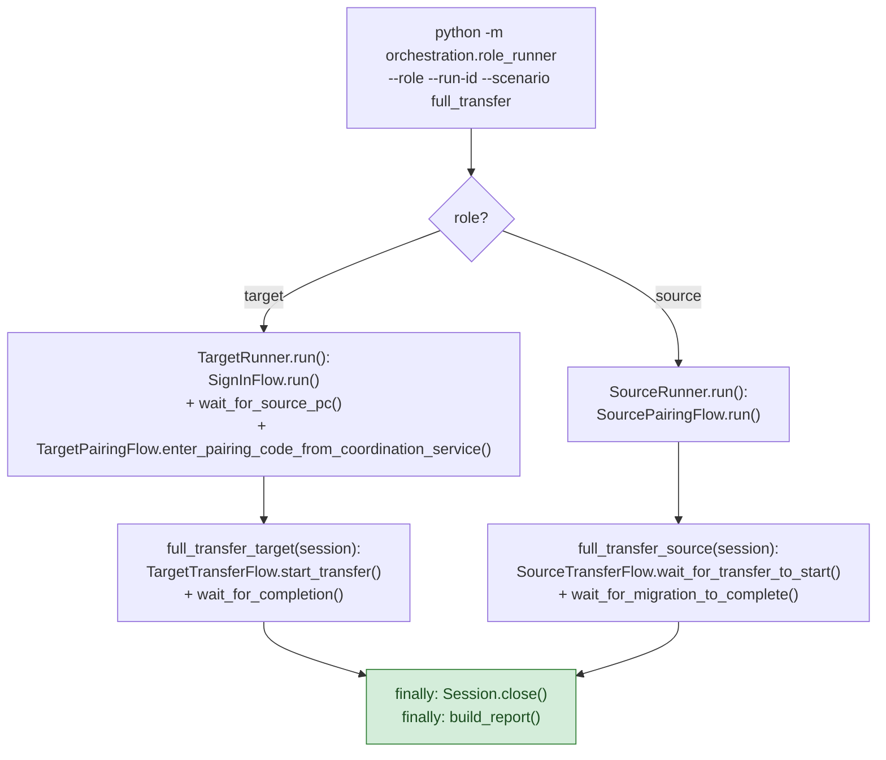

---

## 2a. `SignInFlow.run()` -- top level

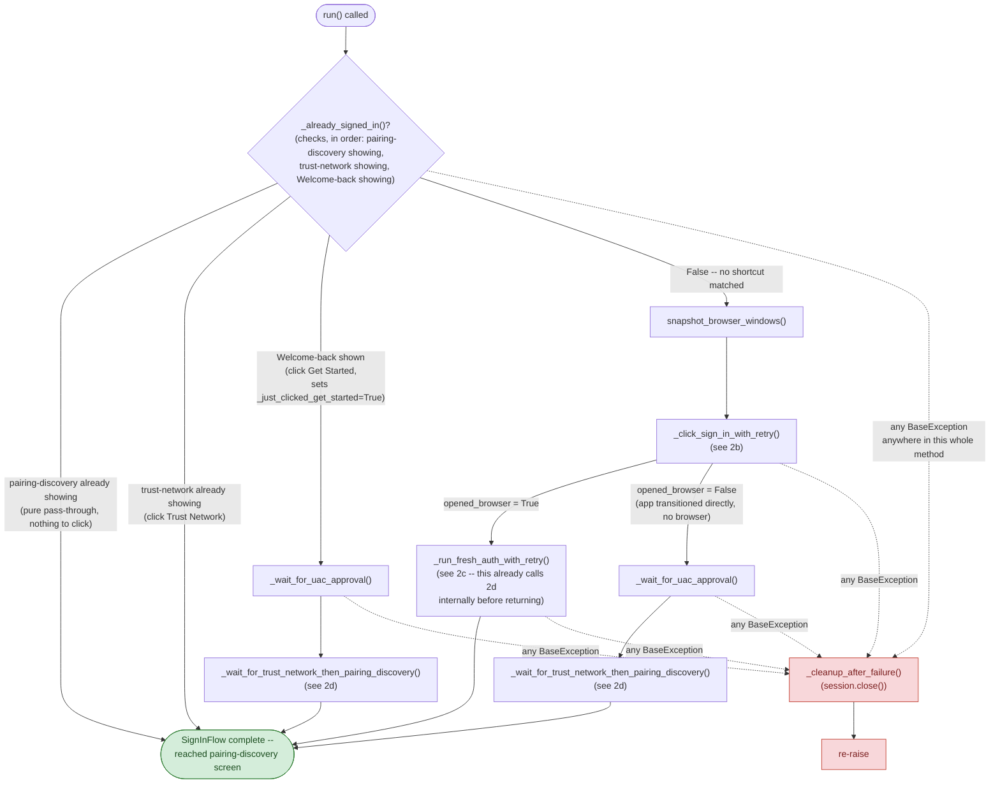

## 2b. `_click_sign_in_with_retry()`

Called only when no already-signed-in shortcut matched. Returns whether a fresh
browser window actually opened.

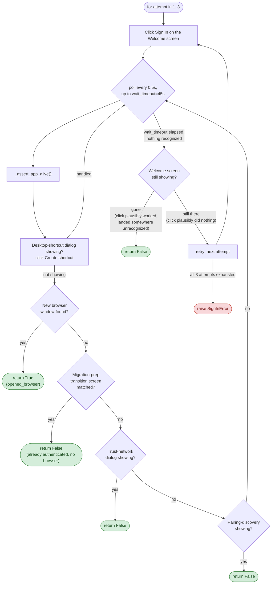

## 2c. `_run_fresh_auth_with_retry()`

Called only when `_click_sign_in_with_retry()` returned `True` (a real browser
opened). `run_negative_check` is `True` only on the very first attempt (`attempt == 0`)
-- every run deliberately submits a wrong OTP once, by design.

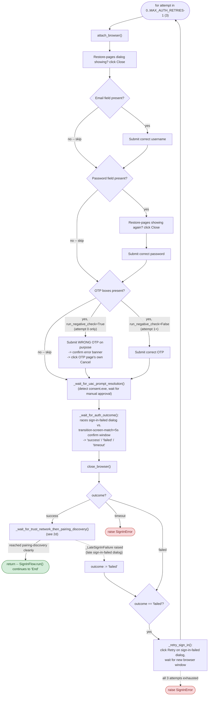

## 2d. `_wait_for_trust_network_then_pairing_discovery()` (shared loop)

Called from **three** places: `run()`'s already-signed-in Welcome-back branch, `run()`'s
no-browser branch, and `_run_fresh_auth_with_retry()`'s success path (2a/2c above).

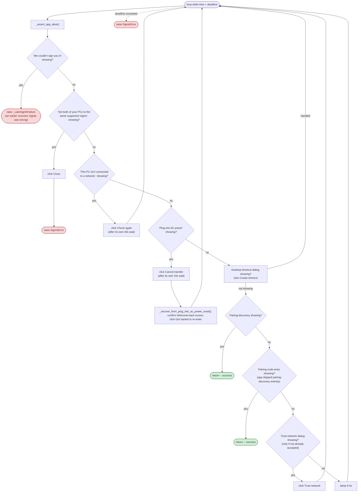

**Known asymmetry, by explicit user direction:** the "Plug into AC power" reset
recovery above (confirm Welcome-back, click Get started) is wired into this loop and
into 2e below, but **not** into `TargetPairingFlow`/`TargetTransferFlow` -- confirmed
to only happen pre-pairing.

## 2e. `wait_for_source_pc()`

Called separately by `orchestration/role_runner.py`'s `TargetRunner.run()`, **after**
`SignInFlow.run()` has already returned successfully.

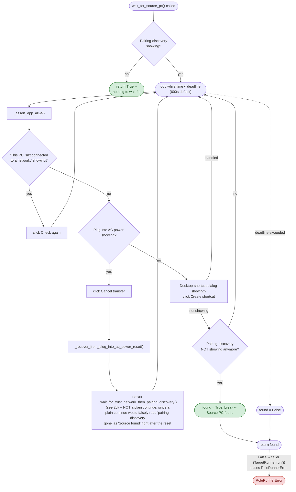

---

## 3. Target -- `TargetPairingFlow`

`enter_pairing_code_from_coordination_service()`, called by `TargetRunner.run()` right
after `wait_for_source_pc()` returns `True`.

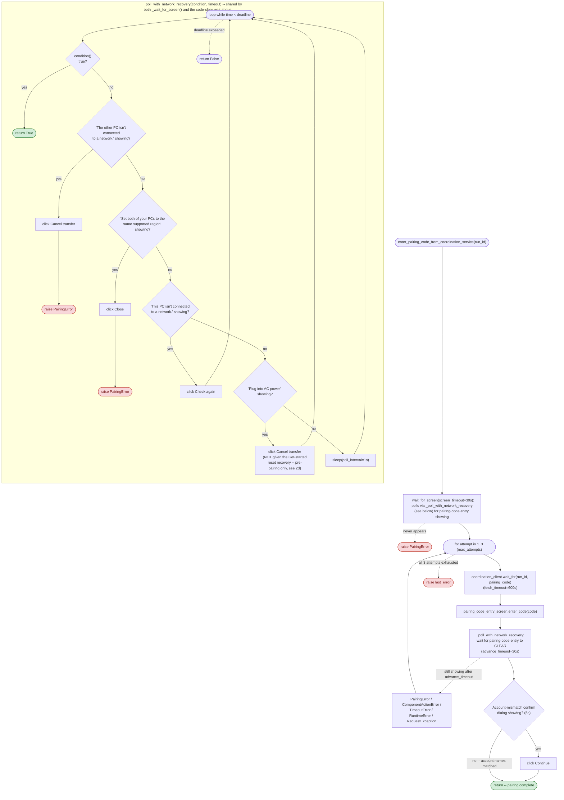

---

## 4a. `start_transfer()`

`flows/target/transfer_flow.py`'s `TargetTransferFlow`, called right after
`TargetPairingFlow` returns.

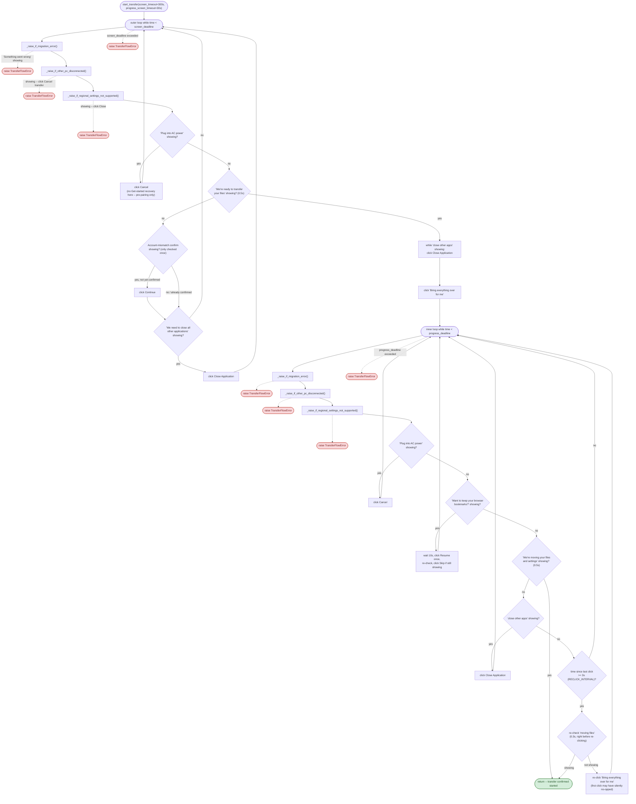

## 4b. `wait_for_completion()`

Called right after `start_transfer()` returns.

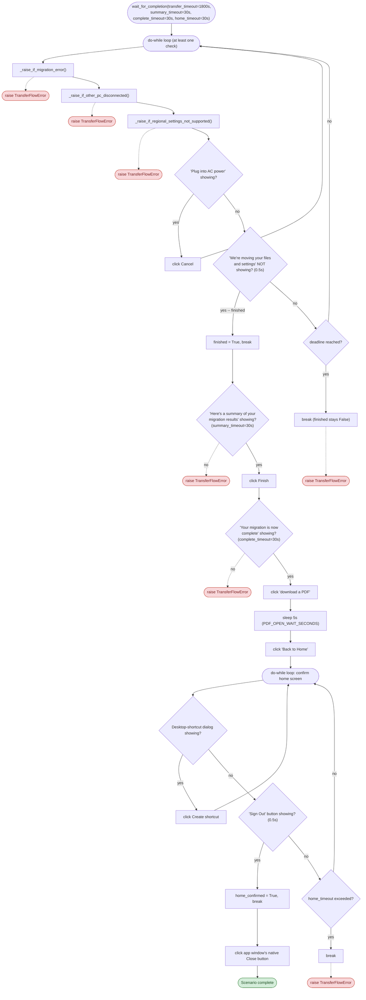

---

## 5. Source -- `SourcePairingFlow`

`flows/source/pairing_flow.py`. **Deadline-extending**: every interrupting dialog
check below pushes the loop's own deadline back by however long it took to handle --
see [DIALOG_HANDLING.md](DIALOG_HANDLING.md)'s cross-cutting notes for why (the
battery-critical dialog in particular is expected to repeat for a long, unpredictable
time).

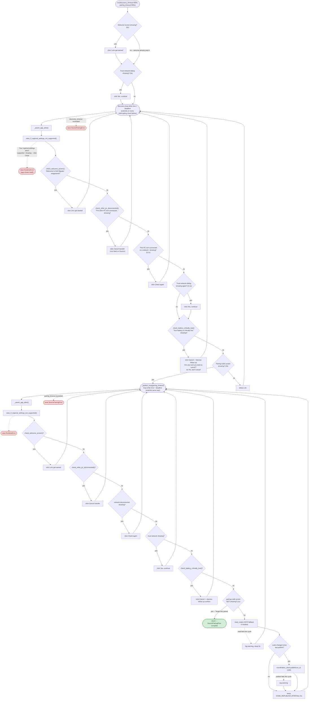

---

## 6. Source -- `SourceTransferFlow`

`flows/source/transfer_flow.py`, called right after `SourcePairingFlow` returns.
`_poll_until_showing()` is a shared helper (same deadline-extending shape as
`SourcePairingFlow`'s loops above) used by both methods below.

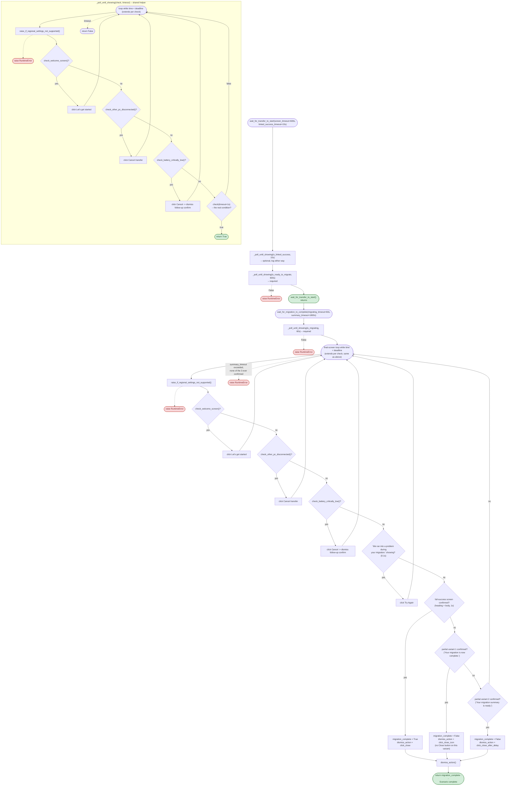
