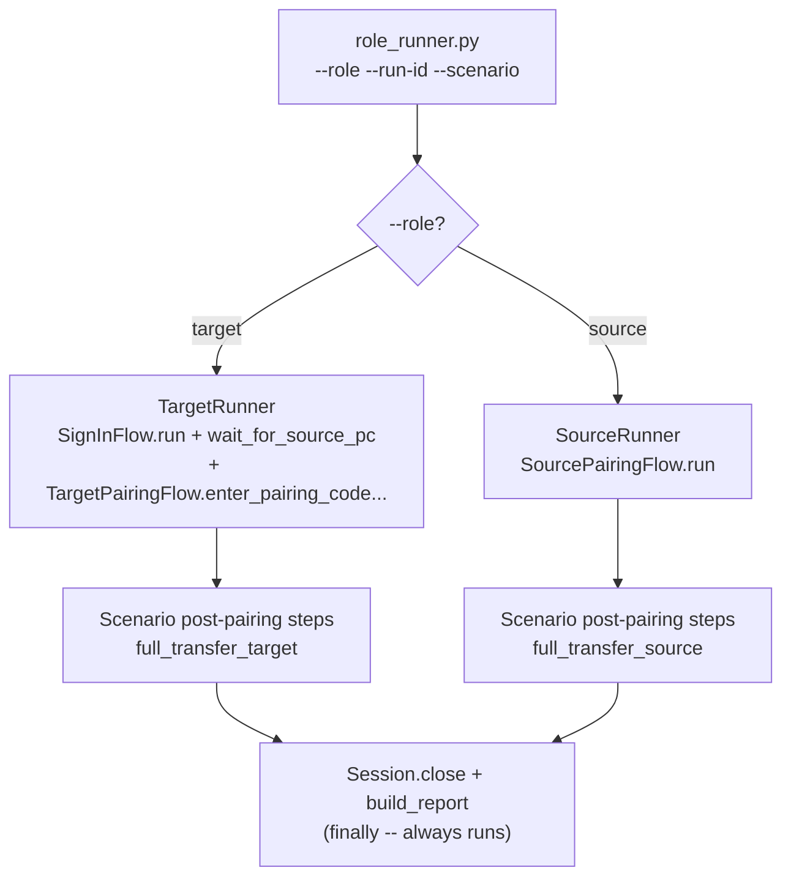
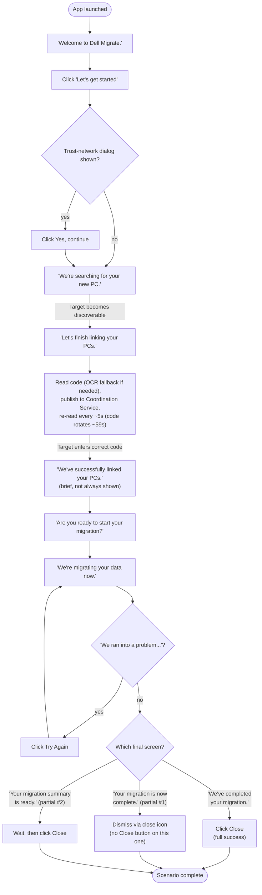

# Test scenarios and coverage

What this automation actually drives and verifies, end to end -- built by reading the
current `orchestration/role_runner.py`, `flows/`, and `validation/` source directly.
See [DIALOG_HANDLING.md](DIALOG_HANDLING.md) for the full catalog of individual
unpredictable dialogs/error conditions each scenario below races against; this document
is about the *scenarios* (the real sequences driven end to end), not the interrupting
dialogs within them. The diagrams below are simplified for readability -- see
[FULL_TRANSFER_FLOW.md](FULL_TRANSFER_FLOW.md) for a precise, one-diagram-per-method
breakdown that maps 1:1 to the actual code (every branch, every loop, every retry),
intended for reviewing/improving the automation itself rather than just understanding
what it covers. See `REGRESSION_AUTOMATION_COVERAGE.md` (local-only, not pushed -- see
`.gitignore`) for how this scenario's coverage lines up against the real Zephyr Scale
regression suite (40 cases exported from `/Migrate/Glassfloor Migrate`) -- it's the
source for most of the "What's not covered today" detail below.

A note on confidence: some paths below are **confirmed live** (the user has watched a
real run exercise them and confirmed the result); others are **built and import-
verified but not yet confirmed live** (the code exists and has been statically checked,
but no one has watched it happen against real hardware). Both are called out
explicitly -- don't read "exists in the code" as "proven to work."

## Scenario framework

`orchestration/role_runner.py` is the one real entry point:
```
python -m orchestration.role_runner --role {target,source} --run-id <id> --scenario full_transfer
```
`--role` picks which machine's flows run in this process (Target and Source are always
two independent processes, coordinated only through the Coordination Service -- never a
single process driving both). `--scenario` picks which post-pairing step sequence runs,
from `SCENARIOS` in `role_runner.py`. **`full_transfer` is the only scenario that exists
today.** The scenario-dispatch architecture (`TargetRunner`/`SourceRunner` owning only
each role's fixed sign-in+pairing/pairing prefix, a scenario function supplying the
post-pairing step list) is built specifically so a second scenario can be added without
touching the prefix logic -- but nothing has used that yet.



## Scenario: `full_transfer`

The one real scenario: sign-in (Target only) + pairing, then a complete file/settings
transfer, for whichever role the process is running as.

### Target side (`TargetRunner` -> `SignInFlow` -> `TargetPairingFlow` -> `TargetTransferFlow`)

```mermaid
flowchart TD
    Start(["App launched"]) --> ClickSignIn["Click Sign In"]
    ClickSignIn --> Shortcut{"Already signed in?"}
    Shortcut -->|"pairing-discovery already showing"| PairingDiscovery
    Shortcut -->|"Welcome-back screen shown"| GetStarted["Click Get Started"]
    Shortcut -->|"no cached session"| Browser["External browser opens"]
    Browser --> Email["Email page (if shown)"]
    Email --> Password["Password page (if shown)"]
    Password --> OTPWrong["Submit WRONG OTP on purpose<br/>(every run's first attempt, by design)"]
    OTPWrong --> CancelOTP["Confirm error banner, click Cancel"]
    CancelOTP --> UAC1["Windows UAC approval"]
    UAC1 --> SignInFailed["'We couldn't sign you in' appears"]
    SignInFailed --> Retry["Click Retry"]
    Retry --> OTPRight["Submit correct email/password/OTP"]
    OTPRight --> UAC2["Windows UAC approval"]
    GetStarted --> PairingDiscovery
    UAC2 --> PairingDiscovery["'We're looking for your other PC'<br/>(trust-network dialog raced continuously<br/>here too -- click Yes if it appears, at any point)"]
    PairingDiscovery -->|"Source PC found --<br/>or the app skipped straight to code entry"| CodeEntry["'Let's connect your two PCs'"]
    CodeEntry --> FetchCode["Fetch code from Coordination Service, type it<br/>(retries up to 3x if it rotates mid-entry)"]
    FetchCode --> AccountMismatch{"Account names differ?"}
    AccountMismatch -->|"yes"| ConfirmAccounts["Click Continue"]
    AccountMismatch -->|"no"| ReadyToMove
    ConfirmAccounts --> ReadyToMove["'Your files are ready to move'"]
    ReadyToMove --> ClickMigrate["Click 'Bring everything over for me'<br/>(periodic re-click if it silently no-ops)"]
    ClickMigrate --> Moving["'We're moving your files and settings'"]
    Moving --> Summary["Migration summary -> click Finish"]
    Summary --> Complete["'Your migration is now complete'"]
    Complete --> DownloadPdf["Click 'download a PDF', wait"]
    DownloadPdf --> BackHome["Click 'Back to Home'"]
    BackHome --> WelcomeBack["Confirmed: Welcome-back home screen"]
    WelcomeBack --> CloseWindow["Close app window"]
    CloseWindow --> Done(["Scenario complete"])
```


*Dialog races (network disconnected, low battery, regional-settings mismatch, the
"install browsers" prompt, etc.) are omitted above for clarity -- see
[DIALOG_HANDLING.md](DIALOG_HANDLING.md) for exactly where each one interrupts this
path and what happens.*

| Stage | What's actually exercised | Confidence |
|---|---|---|
| Sign-in -- fresh browser flow | Click Sign In -> external browser opens -> email page (if shown) -> password page (if shown) -> email-OTP two-step verification -> Windows UAC (manual approval, on the secure desktop) -> back in the app, past the post-auth transition screen(s) | Email/password steps: **not yet confirmed live** (locators inferred from a reference screenshot only -- the test browser profile has consistently had a cached session, so these two steps have never actually been exercised for real). OTP + UAC + post-auth transition: **confirmed live**, repeatedly |
| Sign-in -- deliberate wrong-OTP-then-retry | Every run's first sign-in attempt submits a wrong OTP on purpose, confirms the error banner, clicks the OTP page's own Cancel button, requires real UAC approval, lands on "We couldn't sign you in," clicks Retry, then a second attempt submits the correct values and completes normally | **Confirmed live** -- this is the actual designed behavior, not a bug, and is exercised on every single run by design |
| Sign-in -- 4 "already signed in" shortcuts | (a) Welcome-back screen showing (click Get Started) (b) pairing-discovery already showing (c) trust-network dialog already showing (d) pairing-code-entry already showing -- any of these skips some or all of the browser/OTP sequence above entirely | **Confirmed live** -- the cached-session shortcut has been the common path for most of this session's real runs |
| Sign-in -- late sign-in failure race | A post-OTP transition screen that *looks* like success can still be followed by "We couldn't sign you in" appearing late -- raced for the entire remaining wait, not just a short fixed window, and downgrades to a retry if it fires | **Confirmed live** -- the specific bug this fixed (a transition screen misread as success) was observed directly |
| Pairing-discovery | Waits for "We're looking for your other PC" to clear once the (separately-running) Source process becomes network-discoverable | **Confirmed live**, default 10-minute budget matching the app's own `PairingTimeoutInMilliseconds` |
| Pairing -- code entry | Waits for "Let's connect your two PCs," fetches the current pairing code from the Coordination Service (published by the independent Source-side process, rotates every ~59s), types it, retries the whole fetch+enter cycle up to 3 times if the code rotates out from under a slow entry | **Confirmed live**, including the retry-on-rotation path |
| Pairing -- account-mismatch confirm | "Let's make sure we're connecting the right user accounts" -- only shown when the two PCs' account names differ; clicked through if shown, not treated as a failure if it isn't | **Confirmed live** (both branches: shown and not shown, across different runs) |
| Transfer -- start | Waits for "Your files are ready to move," clicks "Bring everything over for me," periodically re-clicks if the first click silently didn't register, waits for "We're moving your files and settings" to confirm the transfer actually started | **Confirmed live**, including the re-click recovery path |
| Transfer -- completion, full success | Transfer finishes -> migration-summary screen -> click Finish -> "Your migration is now complete" -> click download a PDF -> wait -> click Back to Home -> confirm return to the Welcome-back home screen -> close the app window via its own native close button | **Confirmed live end to end**, including the app's own window-close step |
| Data/category selection | Not automated for either role -- both transfer flows begin at the "ready to move"/"ready to migrate" screens, i.e. after whatever data-selection step the app itself requires | **Not started.** The app is assumed to already be configured for a full transfer (or the user drives this step manually) before the automation's transfer stage begins |

### Source side (`SourceRunner` -> `SourcePairingFlow` -> `SourceTransferFlow`)


*Dialog races (network disconnected, battery critically low, regional-settings
mismatch, the other PC disconnecting, "Welcome to Dell Migrate." reappearing, etc.) are
omitted above for clarity -- see [DIALOG_HANDLING.md](DIALOG_HANDLING.md) for exactly
where each one interrupts this path and what happens.*

| Stage | What's actually exercised | Confidence |
|---|---|---|
| Welcome -> trust-network | Click "Let's get started," accept the trust-network dialog if shown | **Confirmed live** |
| Discovery -> pairing-code publish | Waits for "We're searching for your new PC." to give way to the pairing-code screen, then loops: reads the on-screen code (rotates every ~59s, read via OCR fallback when the UIA tree misses a box) and publishes it to the Coordination Service, until Target enters a correct code | **Confirmed live**, including the OCR-fallback read path and a single-rotation bad-read retry |
| Post-pairing hand-off | "We've successfully linked your PCs." (brief, not confirmed to always appear) -> "Are you ready to start your migration?" -- text-only assertions confirming progress, no click needed | **Confirmed live** |
| Transfer -- migrating | Waits for "We're migrating your data now." to confirm the transfer actually started | **Built, not yet independently confirmed live** via a pasted real run of this exact method |
| Transfer -- completion, 3 possible final screens | Races all three simultaneously: full success ("We've completed your migration." -- Close), partial variant 1 ("Your migration is now complete." -- no Close button, dismissed via its own close icon), partial variant 2 ("Your migration summary is ready." -- Close, but delayed on purpose to give the user a chance to read it first) | **Confirmed live** -- this project was bitten twice by assuming only one partial variant was ever real before both were confirmed and raced together |
| Transfer -- recoverable engine error | "We ran into a problem during your migration." -- not a final outcome, clicks Try Again and keeps polling since the migration restarts | **Confirmed live** via a user-supplied screenshot |

### Launch-mode variations (Target only)

`--launch {exe, mock, simulator}` controls how the Target PC UI app itself is started,
independent of which scenario/role is chosen:
- **`exe`** (default) / **`mock`** -- launch the app directly. Today these are
  identical; `mock` is reserved for a separate GlassFloor entitlement mock server
  (`utils/mock_server.py`) that isn't wired into this path yet.
- **`simulator`** -- launches the app indirectly via the CDM Simulator WPF app (mimics
  Dell SupportAssist, which isn't really integrated yet), requiring
  `DDA_CDM_SIMULATOR_PATH`.
- `--launch` is rejected outright for `--role source` (Source has no equivalent
  launcher concept) -- confirmed by an explicit CLI guard, not just an unused flag.

## Error / interruption recovery (summary -- see DIALOG_HANDLING.md for the full catalog)

Every scenario above runs inside wait loops that simultaneously race a long list of
unpredictable dialogs and conditions -- network disconnection (either PC), critically
low battery / "plug into AC power" (either PC, including a confirmed reset-to-home-
screen cycle on Target that needs its own recovery), regional-settings mismatch between
the two PCs (fatal on both roles), the other PC losing its network connection mid-run,
a missing browser needed to migrate bookmarks, the app's own recoverable engine errors,
and more. None of that is duplicated here -- see
[DIALOG_HANDLING.md](DIALOG_HANDLING.md) for exactly which loop checks for what, how
long, and whether it's fatal.

## Post-migration validation (separate from the scenario above)

`validation/validate_migration.py` is a standalone tool, not part of any scenario above
-- it runs manually, after a migration finishes, and never touches the UI. It cross-
checks a Dell Migrate `MigrationReport-*.pdf`'s own claims against the live PC: every
"Files copied" path checked for real existence on disk, and every "Settings copied"
category's expected registry values (resolved via Dell's own `.reg` backup +
GUID-to-name log mapping) checked against what's actually in the registry right now.
See [README.md](README.md#pdf-migration-report-validation) for full usage and known
limitations (it only reflects the single most recent migration run, a small set of
volatile registry values are excluded, and a flagged mismatch is re-confirmed by
re-reading up to 3 times before being reported).

## What's not covered today

Cross-checked against the real Zephyr Scale regression suite (40 cases, see
`REGRESSION_AUTOMATION_COVERAGE.md`, local-only, not pushed, for the full case-by-case
breakdown) -- 38 of those 40 have a concrete, describable path to
automation; the gaps below are what's actually blocking them, not a fundamental limit of
the approach.

- **Data/category selection is actually THREE undriven screens, not one.** Reading the
  regression suite's real test steps (not just titles) shows the app has a
  **Compatibility check page -> Migration Info page (drive mapping, duplicate
  detection, "Recalculate space") -> Advance migration page (custom file/setting
  selection)** sequence between pairing and "Your files are ready to move" -- none of
  which exist in `locators/`/`assertions/`/`components/`/`flows/` today. Both transfer
  flows assume this is already decided before they start. This single gap is what
  blocks 14 of the 40 regression cases (all of Migration Info & Rescan, all of Files &
  Folders Migration, 6 of them High priority) -- capturing these three screens live is
  the highest-leverage next step for closing regression coverage.
- **Settings-migration verification may already be solved, just not wired to a setup
  step.** `validation/validate_migration.py` + `validation/settings_backup.py` already
  check *any* settings category Dell's PDF report claims to have migrated, by name,
  against the live registry -- generic, not a hardcoded list (README names "High
  Contrast" as a real validated example). ~11 of the regression suite's 23 "Settings
  Migration" cases likely only need a setup script (a registry write or a scripted
  OS-Settings change on the Source PC before a run), not new validation code.
- **Browser-bookmark correctness is a file check, not a UI flow.** ~10 regression cases
  (Firefox/Chrome/Internet Explorer bookmark presence/absence permutations) are better
  verified by reading each browser's own bookmark store (`places.sqlite`, Chrome's
  `Bookmarks` JSON, the IE Favorites folder) directly than by UI-automating three
  browsers -- `InstallBrowsersToMigrateBookmarksDialog` only covers the "missing
  browser" interrupt prompt, not bookmark-content correctness.
- **Multi-PC pairing** (more than one Source PC discoverable on the same network,
  verifying each pairs to the correct partner) -- architecturally possible with the
  existing per-run-id Coordination Service, but needs a 3rd machine and new scenario
  logic; today's flows assume exactly one Target + one Source.
- **A second scenario.** The dispatch architecture supports adding one (e.g. a
  pairing-only smoke test, or a scenario with an extra pre-transfer step) without
  touching the sign-in/pairing prefix logic, but nothing has used that yet --
  `full_transfer` is the only entry in `SCENARIOS`.
- **Pytest-based parametrized scenario tests.** `tests/conftest.py` only provides
  Target-only fixtures (`session`, `credentials`) and the reporting hooks; there are no
  `test_*.py` files today. The live CLI (`role_runner.py`) is the only way this
  automation is actually run end to end right now.
- **Negative pairing-code path.** What the app shows for a *wrong* pairing code has no
  confirmed error text yet -- a rejected code currently just looks like "the entry
  screen never cleared" (a generic timeout), not a distinguishable error. Matches three
  regression cases directly (expired code, invalid code, invalid code over the allowed
  attempt count).
- **Scroll-into-view.** `BaseComponent` has no scroll-into-view logic at all -- not yet
  a problem because no scrollable screen (e.g. a data/category list) is driven today,
  but would need addressing the moment one is (the new Advance Migration page, with a
  file/setting picker, is very likely the first one).
- **Genuinely manual, not just unbuilt:** one regression case (real modem hardware
  required) has no practical automation path today; one more (an OS user-account switch
  mid-test, outside any app's UI) is only partially automatable. See
  `REGRESSION_AUTOMATION_COVERAGE.md` (local-only, not pushed) for both.
